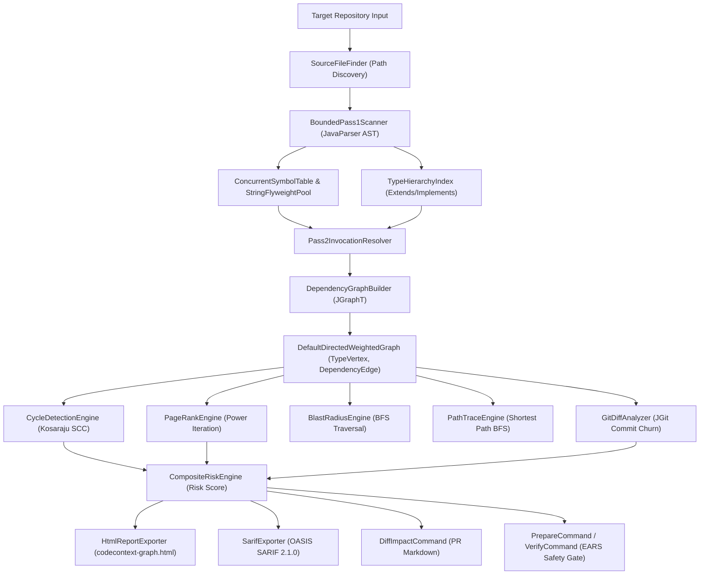
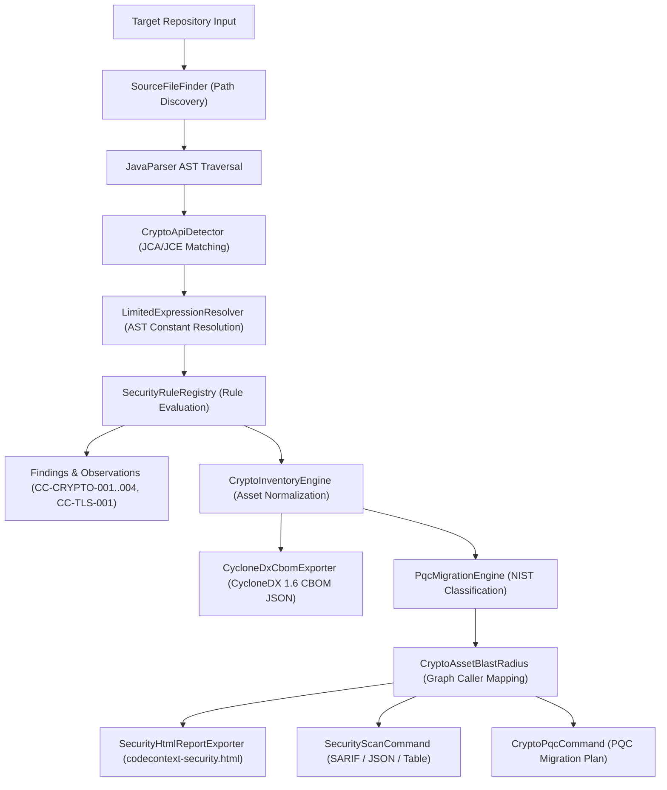

> Correctness clarification: historical counts and claims below describe earlier runs or design intentions. The production scanner does not use StringFlyweightPool. Historical Gson values 722 and 1,333 are total graph vertices (including boundary vertices) and aggregated directed edges, not source classes or call occurrences. The 12 reported paths were truncated cycle examples, not complete enumeration or an SCC count. Graph paths are class-level reachability, not guaranteed runtime execution. Only SCC computation is linear; cycle enumeration and BFS have the documented limits, not fixed resource guarantees. CBOM schema tests cover particular fixtures and do not prove all semantic mappings. See [current correctness report](../CORRECTNESS_REMEDIATION.md).

# CodeContext Java — Architecture Walkthrough & Engine Pipeline Specification

**Audit Date:** 2026-11-14  
**Audit Target:** Merged `main` branch  
**Auditor Role:** Principal Java Engineer & Static Analysis Architect  

---

## 1. High-Level Architecture Overview

CodeContext is a high-performance, offline Java static analysis and change-safety engine designed for large enterprise codebases. It provides:
1. **Architectural Code Intelligence**: Call graphs, circular dependency detection via strongly connected components, PageRank structural hotspot analysis, class-level blast-radius calculation, execution path tracing, and Git-aware pull request diff impact analysis.
2. **Cryptographic Security & PQC Intelligence**: JCA/JCE cryptographic API usage detection, AST-based expression resolution, static vulnerability rule evaluation, Cryptography Bill of Materials (CBOM) generation complying with CycloneDX 1.6, and Post-Quantum Cryptography (PQC) exposure classification aligned with NIST FIPS 203/204/205.

### Module Topology
- **`codecontext-core`**: The foundational analysis library. Contains the two-pass JavaParser scanner, lexical scope resolver, concurrent symbol table, JGraphT dependency graph builder, graph analytics engines, security rule registry, cryptographic inventory engine, and PQC migration engine. Zero external network dependencies.
- **`codecontext-cli`**: Picocli-powered command-line interface. Orchestrates analysis workflows, formats outputs (ANSI console tables, JSON, OASIS SARIF 2.1.0, Markdown PR summaries), generates standalone offline HTML reports (`HtmlReportExporter` for architecture; `SecurityHtmlReportExporter` for security & PQC), and enforces change-safety verification gates.
- **`codecontext-service`**: Headless daemon/service module stub for background index synchronization.

---

## 2. End-to-End Analysis Pipelines

The system maintains two distinct, specialized analysis pipelines. They operate independently to ensure strict separation of concerns, deterministic execution, and zero cross-contamination of data structures.

### Pipeline A: Architectural Graph Intelligence Pipeline

#### Step-by-Step Architectural Execution:
1. **Source Discovery (`SourceFileFinder`)**: Recursively discovers `.java` files while honoring standard exclusions (`.git`, `build`, `target`, `node_modules`). Configurable to include or exclude test directories (`src/test`).
2. **Pass 1 Declaration Indexing (`BoundedPass1Scanner`)**: Parses each compilation unit into a JavaParser AST. Extracts package names, import declarations, class/interface definitions, method signatures, and field declarations into `TypeDefinition` records.
3. **Symbol Table & Memory Optimization (`ConcurrentSymbolTable`, `StringFlyweightPool`)**: All type names, package identifiers, and member signatures are deduplicated via `StringFlyweightPool` to bound memory consumption across multi-thousand-file repositories.
4. **Hierarchy Indexing (`TypeHierarchyIndex`)**: Builds an index of inheritance relationships (`extends` and `implements`), enabling polymorphic method dispatch approximation and supertype traversal.
5. **Pass 2 Invocation Resolution (`Pass2InvocationResolver`)**: Re-traverses compilation units with a `LexicalScopeStack` and `ResolutionChain`. Resolves method call expressions, constructor invocations, and static member accesses to target types.
6. **Graph Construction (`DependencyGraphBuilder`)**: Constructs a JGraphT `DefaultDirectedWeightedGraph<TypeVertex, DependencyEdge>`. Vertices represent unique types (FQCN); directed edges represent caller-to-callee dependencies weighted by invocation frequency.
7. **Graph Analytics**:
   - `CycleDetectionEngine`: Employs `KosarajuStrongConnectivityInspector` to identify Strongly Connected Components (SCC) in $O(V + E)$ time, followed by bounded elementary cycle extraction.
   - `PageRankEngine`: Computes structural centrality using power iteration over incoming dependency edges.
   - `BlastRadiusEngine`: Performs bounded breadth-first search (BFS) on inverted dependency edges to calculate upstream caller reachability.
   - `PathTraceEngine`: Computes the shortest call chain between two components, preserving exact call sites and line numbers.
   - `GitDiffAnalyzer`: Uses JGit to inspect commit diffs and map modified files to graph vertices.
8. **Export**: Emits self-contained visual HTML blueprints, SARIF 2.1.0, JSON summaries, or EARS change-safety plans.

---

### Pipeline B: Cryptographic Security & Post-Quantum Intelligence Pipeline

#### Step-by-Step Security & PQC Execution:
1. **API Discovery (`CryptoApiDetector`)**: Scans AST method calls against a catalog of Java Cryptography Architecture (JCA) owners: `Cipher`, `MessageDigest`, `Signature`, `KeyGenerator`, `KeyPairGenerator`, `KeyAgreement`, `Mac`, `SecureRandom`, and `SSLContext`.
2. **Expression Resolution (`LimitedExpressionResolver`)**: Analyzes method arguments using static AST analysis:
   - Direct string literals (`"AES/GCM/NoPadding"`)
   - Intra-class `static final` constants
   - Trivial string concatenations (`ALGO + "/ECB/PKCS5Padding"`)
   - Unresolved arguments (e.g. `properties.getProperty(...)`, method parameters) are flagged with `ResolutionStatus.UNKNOWN` rather than fabricated or guessed.
3. **Rule Evaluation (`SecurityRuleRegistry`)**:
   - `CC-CRYPTO-001` (`EcbModeSecurityRule`): Detects symmetric ECB mode while strictly exempting asymmetric RSA transformations (`RSA/ECB/OAEP...`).
   - `CC-CRYPTO-002` (`LegacyCipherSecurityRule`): Detects broken ciphers (`DES`, `DESede`, `RC2`, `RC4`, `Blowfish`).
   - `CC-CRYPTO-003` (`WeakDigestSecurityRule`): Flags collision-broken digests (`MD5`, `SHA-1`) with contextual review remediation.
   - `CC-CRYPTO-004` (`ProviderDependentCipherSecurityRule`): Flags bare unpadded algorithm strings (e.g., `Cipher.getInstance("AES")`).
   - `CC-TLS-001` (`ObsoleteTlsSecurityRule`): Flags obsolete protocols (`SSLv3`, `TLSv1.0`, `TLSv1.1`).
4. **Inventory Normalization (`CryptoInventoryEngine`)**: Collates observations into normalized `CryptoAsset` instances with primitive classification (`BLOCK_CIPHER`, `PUBLIC_KEY_ENCRYPTION`, `HASH`, `KEY_PAIR_GENERATOR`, `DRBG`).
5. **CBOM Export (`CycloneDxCbomExporter`)**: Generates official CycloneDX 1.6 Cryptography Bill of Materials with cryptographic properties, algorithm characteristics, and occurrence evidence.
6. **PQC Migration Assessment (`PqcMigrationEngine`)**: Classifies each asset into one of four distinct categories:
   - `PQC_MIGRATION_CANDIDATE`: Asymmetric public-key algorithms vulnerable to Shor's algorithm (RSA, ECDH, ECDSA).
   - `CLASSICAL_REMEDIATION`: Classically broken ciphers and digests (DES, MD5, SHA-1).
   - `QUANTUM_CONSIDERATION`: Modern symmetric ciphers and hash functions (AES-256, SHA-384, SHA-512) requiring key-length evaluation under Grover's algorithm.
   - `UNKNOWN_OR_UNRESOLVED`: Dynamic algorithm strings and provider-dependent implementations (e.g., `SHA1PRNG`).
7. **Graph-Based Blast Radius (`CryptoAssetBlastRadius`)**: Bridges the cryptographic asset to the JGraphT call graph. Traverses caller edges in the direction `Caller -> Callee` to calculate depth-1 direct caller classes and depth $\ge 2$ transitive-only callers, cleanly reporting shared utility fan-in.
8. **Export**: Generates the standalone offline security dashboard (`SecurityHtmlReportExporter`) featuring 6 tabs, zero external HTTP dependencies, and KaTeX/Chart rendering.

---

## 3. Concurrency, Memory & Reliability Engineering

- **Thread Safety**: The symbol table (`ConcurrentSymbolTable`) uses concurrent hash maps and copy-on-write collections to allow concurrent scanning.
- **Bounded Traversal**: All graph traversals (`BlastRadiusEngine`, `PathTraceEngine`, `CycleDetectionEngine`) enforce strict depth and iteration boundaries to prevent infinite recursion on cyclical graphs.
- **Resource Management**: All file parsing utilizes try-with-resources and bounded NIO streams.
- **Memory Optimization**: `StringFlyweightPool` canonicalizes type strings, reducing heap footprint during large multi-thousand-file scans.
