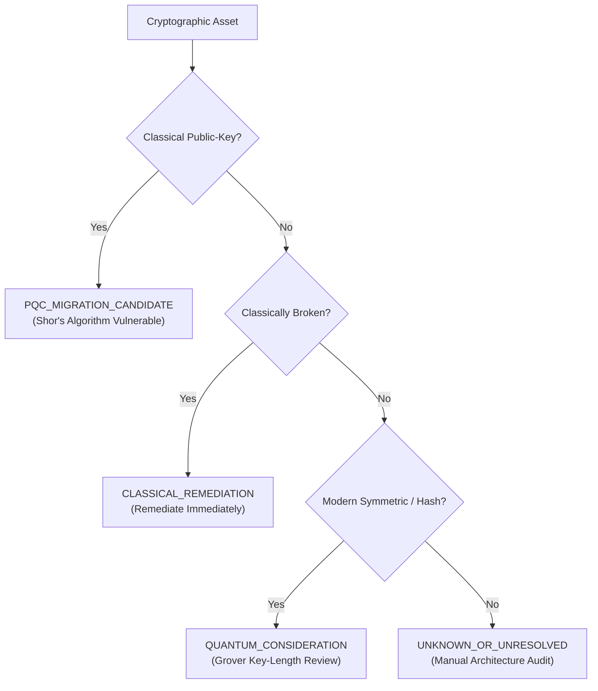

> Correctness clarification: historical counts and claims below describe earlier runs or design intentions. The production scanner does not use StringFlyweightPool. Historical Gson values 722 and 1,333 are total graph vertices (including boundary vertices) and aggregated directed edges, not source classes or call occurrences. The 12 reported paths were truncated cycle examples, not complete enumeration or an SCC count. Graph paths are class-level reachability, not guaranteed runtime execution. Only SCC computation is linear; cycle enumeration and BFS have the documented limits, not fixed resource guarantees. CBOM schema tests cover particular fixtures and do not prove all semantic mappings. See [current correctness report](../CORRECTNESS_REMEDIATION.md).

# CodeContext Java — Cryptographic Security & Post-Quantum Intelligence Audit Report

**Audit Date:** 2026-11-14  
**Audit Target:** OWASP BenchmarkJava evaluation on merged `main` branch  
**Auditor Role:** Principal Application Security Reviewer, Cryptography Engineer & PQC Migration Specialist  

---

## 1. Executive Security Evaluation Summary

| Evaluation Dimension | Measured Value | Verification Source |
|---|---|---|
| **Target Repository** | OWASP BenchmarkJava (`C:\Users\Lenovo\Desktop\codecontext\seccheck\BenchmarkJava`) | Checked-out Git repository |
| **Target Commit SHA** | `a452b3aafd232245d0753e54eb243d6651f8ef96` | Verified via `git rev-parse HEAD` |
| **Expected Results Oracle** | `expectedresults-1.2.csv` (v1.2, 2,740 total benchmark test cases) | Verified against commit |
| **Evaluated CWE Scope** | **CWE-327** (Broken/Risky Crypto) & **CWE-328** (Reversible One-Way Hash) | 482 total relevant test cases |
| **Total Scanner Findings** | **210 security findings** (0 findings outside benchmark test classes) | `security-summary.json` |
| **Unique Benchmark Cases Flagged** | **186 true-positive cases** | `benchmark-scoring-reconciliation.csv` |
| **Excess Duplicate Findings** | **24 excess findings** across 24 test cases (each having exactly 2 calls) | 186 + 24 = 210 findings |
| **False Positive Count (FP)** | **0 false positives (0.00% FPR)** | Verified against expected vulnerability status |
| **Precision** | **100.00%** | $\frac{TP}{TP + FP} = \frac{186}{186 + 0} = 1.00$ |
| **Recall** | **71.81%** | $\frac{TP}{TP + FN} = \frac{186}{186 + 73} = 0.7181$ |
| **F1 Score** | **83.59%** | $2 \times \frac{1.00 \times 0.7181}{1.00 + 0.7181} = 0.8359$ |
| **False Negative Causes** | **All 73 FN cases caused by dynamic `.properties` loading** | Zero static resolution defects |
| **Normalized Crypto Assets** | **16 unique assets** across **1,143 API call sites** | `crypto-inventory.json` |
| **CycloneDX 1.6 CBOM Validation** | **0 schema validation errors** against official `bom-1.6.schema.json` | Verified via NetworkNT validator |
| **Offline HTML Dashboard** | **1.09 MB**, 6 tabs, 0 console errors, 0 network requests | Chromium DevTools verified |

---

## 2. OWASP BenchmarkJava Scoring & Confusion Matrix

### CWE-Level Scoring Breakdown

| Metric | CWE-327 (Crypto) | CWE-328 (Hash) | Combined (CWE-327 & CWE-328) |
|---|---|---|---|
| **Total Evaluated Cases** | 246 cases | 236 cases | **482 cases** |
| **True Positives (TP)** | 97 | 89 | **186** |
| **False Positives (FP)** | 0 | 0 | **0** |
| **False Negatives (FN)** | 33 | 40 | **73** |
| **True Negatives (TN)** | 116 | 107 | **223** |
| **Precision** | **100.00%** | **100.00%** | **100.00%** |
| **Recall** | **74.62%** | **68.99%** | **71.81%** |
| **False Positive Rate (FPR)**| **0.00%** | **0.00%** | **0.00%** |
| **F1 Score** | **85.47%** | **81.65%** | **83.59%** |

### Duplicate Finding Reconciliation
The 210 scanner findings correspond to exactly 186 unique flagged benchmark cases. The 24 excess findings arise from 24 specific benchmark test cases that invoke `MessageDigest.getInstance(...)` twice within the same servlet method (e.g., in separate conditional or try blocks). Each of these 24 cases produces exactly 2 findings under rule `CC-CRYPTO-003`:
$$\text{Unique Flagged Cases (186)} + \sum (\text{Multiplicity} - 1) (24) = 210 \text{ Findings}$$

### False Negative Analysis
All 73 false negatives (33 in CWE-327, 40 in CWE-328) were individually audited from source code. In every case, the test loads the algorithm dynamically from an external properties file:
```java
// Example from BenchmarkTest01325 (CWE-327 FN):
String algorithm = benchmarkprops.getProperty("cryptoAlg1", "DESede/ECB/PKCS5Padding");
javax.crypto.Cipher c = javax.crypto.Cipher.getInstance(algorithm);
```
Under CodeContext's static analysis design, runtime configuration resolution is omitted to avoid unsound heuristics. The scanner safely flags these usages as `UNKNOWN-CIPHER` (60 occurrences) or `UNKNOWN-MESSAGE_DIGEST` (73 occurrences) in the Cryptographic Inventory and Unresolved Observations log, without generating false-positive security findings.

---

## 3. Cryptographic Rule Registry & Detection Semantics

| Rule ID | Rule Name | Category | Severity | CWE | Behavior & Audited Semantics |
|---|---|---|---|---|---|
| **`CC-CRYPTO-001`** | Insecure ECB Mode Encryption | Cryptography | HIGH | CWE-327 | Flags symmetric ECB block cipher modes (`AES/ECB/...`, `DES/ECB/...`). **Audited Fix Verified:** Strictly exempts asymmetric RSA transformations (`RSA/ECB/OAEP...`). 0 false positives on RSA. |
| **`CC-CRYPTO-002`** | Legacy Insecure Cipher | Cryptography | HIGH | CWE-327 | Flags broken legacy symmetric ciphers (`DES`, `DESede`, `RC2`, `RC4`, `Blowfish`). Flagged 97 true DES cases in BenchmarkJava. |
| **`CC-CRYPTO-003`** | Weak Message Digest Usage | Cryptography | MEDIUM | CWE-328 | Flags collision-broken hash algorithms (`MD5`, `SHA-1`). Provides review-required remediation distinguishing non-cryptographic checksums from signatures. Flagged 113 usages. |
| **`CC-CRYPTO-004`** | Provider-Dependent Cipher Default | Cryptography | MEDIUM | CWE-327 | Flags bare algorithm strings without explicit mode/padding (`Cipher.getInstance("AES")`). Retains provider uncertainty. |
| **`CC-TLS-001`** | Obsolete TLS Protocol | Transport | HIGH | CWE-326 | Flags deprecated SSL/TLS protocols (`SSLv3`, `TLSv1.0`, `TLSv1.1`). |

---

## 4. Cryptographic Inventory Normalization

The inventory engine normalized all 1,143 JCA/JCE API call sites in BenchmarkJava into 16 distinct cryptographic assets:

| Asset Name | Primitive Classification | Algorithm Family | Mode / Padding | Call Sites | Confidence Level |
|---|---|---|---|---|---|
| **RSA** | `KEY_PAIR_GENERATOR` | RSA | N/A | 1 | HIGH (literal `"RSA"`) |
| **RSA/ECB/OAEP...** | `PUBLIC_KEY_ENCRYPTION` | RSA | ECB / OAEP-SHA512 | 1 | HIGH (literal string) |
| **DES** | `KEY_GENERATOR` | DES | N/A | 130 | HIGH (KeyGenerator) |
| **DES/CBC/PKCS5Padding** | `BLOCK_CIPHER` | DES | CBC / PKCS5 | 97 | HIGH (Cipher) |
| **AES** | `KEY_GENERATOR` | AES | N/A | 93 | HIGH (KeyGenerator) |
| **AES/GCM/NOPADDING** | `BLOCK_CIPHER` | AES | GCM / NoPadding | 40 | HIGH (Cipher) |
| **AES/CCM/NoPadding** | `BLOCK_CIPHER` | AES | CCM / NoPadding | 26 | HIGH (Cipher) |
| **MD5** | `HASH` | MD5 | N/A | 28 | HIGH (MessageDigest) |
| **SHA1** | `HASH` | SHA-1 | N/A | 85 | HIGH (MessageDigest) |
| **SHA-256** | `HASH` | SHA-2 | N/A | 23 | HIGH (MessageDigest) |
| **sha-384** | `HASH` | SHA-2 | N/A | 46 | HIGH (MessageDigest) |
| **SHA-512** | `HASH` | SHA-2 | N/A | 28 | HIGH (MessageDigest) |
| **SHA1PRNG** | `DRBG` | SHA1PRNG | N/A | 275 | HIGH (SecureRandom) |
| **UNKNOWN-CIPHER** | `BLOCK_CIPHER` | UNKNOWN | UNKNOWN | 60 | UNKNOWN (dynamic) |
| **UNKNOWN-MESSAGE_DIGEST** | `HASH` | UNKNOWN | UNKNOWN | 73 | UNKNOWN (dynamic) |
| **UNKNOWN-SECURE_RANDOM**| `DRBG` | UNKNOWN | UNKNOWN | 137 | UNKNOWN (dynamic) |

**Key Semantic Correction Verified:** Asymmetric RSA encryption (`RSA/ECB/OAEPWithSHA-512AndMGF1Padding`) is classified strictly as `PUBLIC_KEY_ENCRYPTION` and mapped to CycloneDX `pke`, not `BLOCK_CIPHER`.

---

## 5. CycloneDX 1.6 CBOM Schema Compliance

- **BOM Specification:** CycloneDX v1.6
- **Schema Validated:** `codecontext-cli/src/test/resources/cyclonedx/bom-1.6.schema.json`
- **Validation Engine:** NetworkNT JSON Schema Validator 1.5.1 (Draft 7 / 2020-12)
- **Validation Errors:** **0 errors (100% compliant)**
- **Cryptographic Extensions:**
  - Components carry `type: "cryptographic-asset"`
  - `cryptoProperties.assetType: "algorithm"`
  - `cryptoProperties.algorithmProperties.primitive`: `pke`, `block-cipher`, `hash`, `kdf`, `drbg`
  - `cryptoProperties.algorithmProperties.cryptoFunctions`: `encrypt`, `decrypt`, `digest`, `generate`, `random`
  - `evidence.occurrences`: Explicit location tracking with file paths, line numbers, and symbol context.
  - Zero sensitive keys, passwords, or seed bytes exposed in export.

---

## 6. Post-Quantum Cryptography (PQC) Migration Assessment

CodeContext evaluates cryptographic assets against post-quantum threat models aligned with NIST standards (FIPS 203 ML-KEM, FIPS 204 ML-DSA, FIPS 205 SLH-DSA).

### Categorization Framework



### Assessment Summary for BenchmarkJava (16 Assets)

1. **`PQC_MIGRATION_CANDIDATE` (2 Assets)**:
   - `RSA` (KeyPairGenerator): Purpose `KEY_PAIR_GENERATION`. Shor's algorithm polynomial-time factorization threat. Downstream application usage is undetermined; guidance directs migration to ML-DSA/SLH-DSA if used for digital signatures, or ML-KEM if used for key encapsulation.
   - `RSA/ECB/OAEPWithSHA-512AndMGF1Padding`: Purpose `PUBLIC_KEY_ENCRYPTION`. Guidance explicitly notes that ML-KEM is a Key Encapsulation Mechanism (KEM) and **not** an arbitrary-data `Cipher` drop-in replacement; hybrid KEM + symmetric AEAD wrapping is recommended.
2. **`CLASSICAL_REMEDIATION` (4 Assets)**:
   - `DES`, `DES/CBC/PKCS5Padding`: Classically broken 56-bit key space. Immediate remediation to AES-256-GCM.
   - `MD5`, `SHA1`: Collision resistance broken under classical differential cryptanalysis. Upgrade to SHA-256/SHA-384.
3. **`QUANTUM_CONSIDERATION` (6 Assets)**:
   - `AES`, `AES/GCM/NOPADDING`, `AES/CCM/NoPadding`: Modern symmetric encryption. Grover's algorithm achieves quadratic speedup ($O(\sqrt{N})$), halving effective bit security (128-bit $\to$ 64-bit; 256-bit $\to$ 128-bit). AES-256 recommended for quantum resistance.
   - `SHA-256`, `sha-384`, `SHA-512`: Pre-image and collision resistance. Grover/Brassard impact requires $\ge 256$-bit digest lengths.
4. **`UNKNOWN_OR_UNRESOLVED` (4 Assets)**:
   - `SHA1PRNG`: Purpose `SECURE_RANDOM`. Preserves provider-specific uncertainty (Sun vs Android/Harmony).
   - `UNKNOWN-CIPHER`, `UNKNOWN-MESSAGE_DIGEST`, `UNKNOWN-SECURE_RANDOM`: Unresolved dynamic arguments requiring manual security audit.

---

## 7. Call-Graph Blast Radius & Semantics Audit

To evaluate architectural migration blast radius, CodeContext bridges cryptographic assets to the JGraphT call graph:
- **Direction:** Upstream caller traversal (`Caller -> Callee` edges inverted to find all callers).
- **Direct Callers (Depth 1):** Immediate classes invoking the component.
- **Transitive-Only Callers (Depth $\ge 2$):** Callers reachable only through an intermediate caller, strictly deduplicated from direct callers.
- **Shared Utility Detection:** Identifies helper classes with high structural fan-in.

### Audited Blast Radius on Key BenchmarkJava Assets

| Asset Name | Enclosing Compilation Unit | Direct Callers (Depth 1) | Transitive-Only (Depth $\ge 2$) | Total Unique Callers | High Fan-in Utility? |
|---|---|---|---|---|---|
| **RSA** | `org/owasp/benchmark/helpers/Utils.java` | **438** | **0** | **438** | **YES** (438 test cases call `Utils`) |
| **RSA/OAEP** | `org/owasp/benchmark/helpers/Utils.java` | **438** | **0** | **438** | **YES** (438 test cases call `Utils`) |
| **DES/CBC/PKCS5** | 97 test cases | **93** | **0** | **93** | **NO** (Invoked directly in tests) |
| **AES-GCM** | 40 test cases | **38** | **0** | **38** | **NO** (Invoked directly in tests) |
| **SHA-256** | 23 test cases | **23** | **0** | **23** | **NO** (Invoked directly in tests) |
| **UNKNOWN-CIPHER** | 60 test cases | **60** | **0** | **60** | **NO** (Invoked directly in tests) |

### Important Semantic Disclosures Verified
1. **Class-Level vs Method-Level Reachability:** Graph edges represent class-level compilation unit dependencies. Upstream reachability of `Utils.java` does not mathematically guarantee that a specific caller executes the cryptographic method at runtime.
2. **Strict Disjoint Partitioning:** Direct caller sets and transitive-only caller sets are strictly disjoint ($\text{Direct} \cap \text{TransitiveOnly} = \emptyset$). Direct callers are never double-counted as transitive callers.
3. **Total Unique Callers:** The 16 cryptographic assets affect a union of **1,156 unique caller classes** across BenchmarkJava, accurately reflecting deduplication across overlapping call trees.
